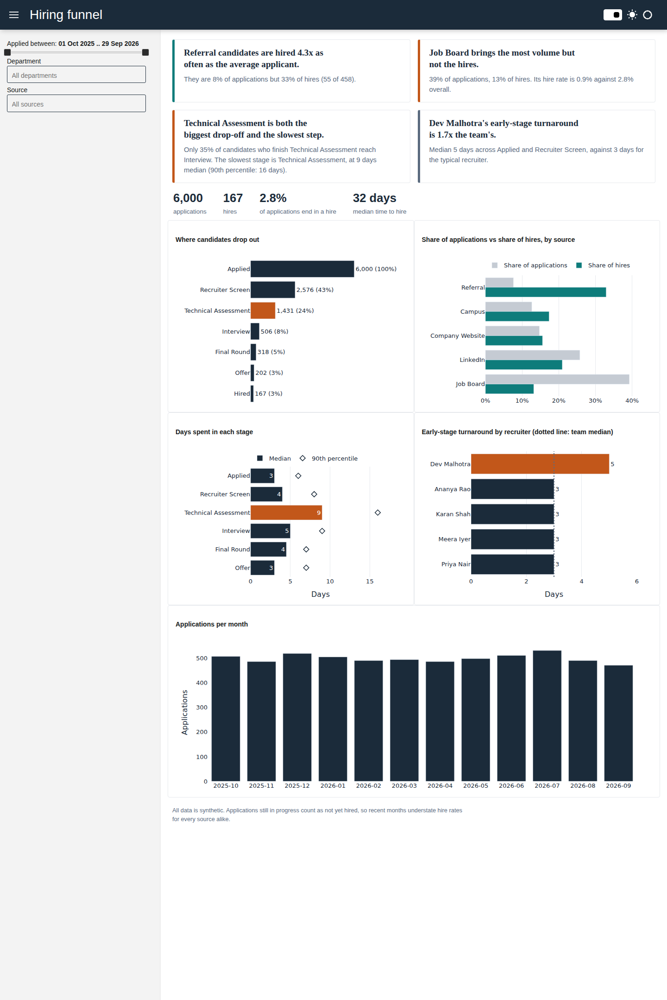

# Hiring Funnel Analyzer

A Python analytics app that answers three questions a talent-acquisition leader actually asks:
**where do candidates drop out, which sources produce hires, and where is the process slow?**

It generates a realistic (fully synthetic) year of recruiting data, stores it in a SQL star schema,
computes funnel metrics with parameterised SQL, writes plain-language findings, and serves everything
in an interactive Panel dashboard.



> No real candidate data is used anywhere. Recruiter names are fictional. Real HR data is sensitive,
> so the whole pipeline is built to run on a synthetic stand-in with the same shape.

## Quick start

```bash
pip install -r requirements.txt
pytest -q                      # 27 tests
panel serve app.py --show      # builds data/funnel.db on first run, then opens the dashboard
```

To rebuild the database with different parameters:

```bash
python -m hiring_funnel.build_db --n 10000 --seed 42
```

## How it is put together

```
generate.py   HiringDataGenerator  ->  six DataFrames (seeded, reproducible)
warehouse.py  Warehouse            ->  SQLite star schema, constraints, bulk load
metrics.py    FunnelMetrics        ->  parameterised SQL + pandas for each dashboard view
insights.py   InsightEngine        ->  turns metric tables into one-sentence findings
charts.py                          ->  Plotly figures (colour carries meaning)
dashboard.py                       ->  Panel app: filters -> one bound view
```

### Star schema

```
dim_source ──┐                              ┌── dim_stage
dim_role ────┼── fact_application ──────────┤
dim_recruiter┘   (1 row / application)      │
                        │                   │
                        └── fact_stage_event ┘
                            (1 row / application / stage reached)
```

- `fact_application` has one row per application with its outcome (`Hired`, `Rejected`, `In Progress`).
- `fact_stage_event` has one row per stage an application reached, with entry/exit dates and days in stage.
  Funnel counts and time-in-stage both come from this table.
- Foreign keys are enforced (`PRAGMA foreign_keys = ON`) and `outcome` has a `CHECK` constraint.

## Design decisions

- **Parameterised SQL only.** Dashboard filters are passed as bound parameters and never interpolated
  into SQL text. A test feeds a hostile filter value (`'); DROP TABLE ...`) and checks the data survives.
- **Findings, not just charts.** The top of the dashboard states what the data says
  ("Referral candidates are hired 4x as often as the average applicant"). Each finding has a minimum
  sample size, so a thin filter selection produces no finding rather than a misleading one.
- **Colour means something.** Teal marks what is working, burnt orange marks what needs attention,
  and the same orange bar appears in the chart that backs each warning.
- **Reproducible.** The generator is seeded; the same seed always gives the same database.
- **The tests check the insights, not just the code.** The generator plants three patterns
  (a high-volume, low-yield source; a bottleneck stage; one slow recruiter) and
  `tests/test_insights.py` asserts the engine finds each one.

## Known limitations

- Applications still in progress count as "not hired", so the most recent months understate hire rates.
  It affects every source alike, so comparisons between sources hold, and the dashboard says so.
- "Biggest drop-off" is measured on raw stage-to-stage conversion. It does not control for role mix.
- SQLite keeps this runnable anywhere. The schema and queries are standard SQL, and the `Warehouse`
  class is the only place that knows about the database engine.

## Ideas for next steps

- Swap SQLite for Postgres or SQL Server behind `Warehouse`.
- Add a cohort view (hire rate by month of application, excluding still-open applications).
- Add a date dimension table and a time-to-hire distribution by department.
